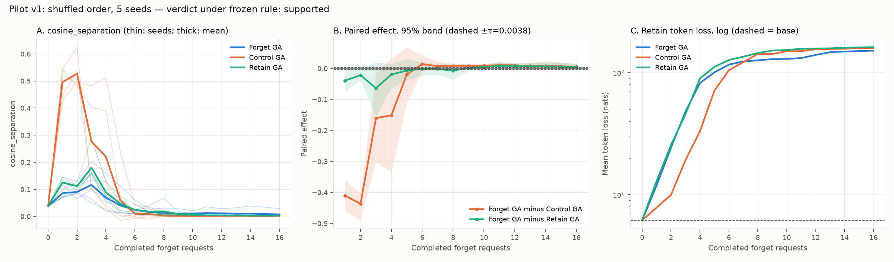
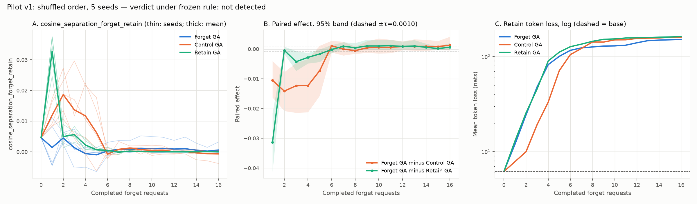

# Pilot v1 results

Pre-registration: `docs/protocol.md` v1.0 (frozen in commit `4358733`, before any
main-run metrics existed). Main run on Kaggle (2× Tesla T4, one used), finished
2026-10-16. Analysis code: `scripts/06_analyze.py` (paired effects; re-run locally and
identical to the Kaggle output) and `scripts/07_apply_protocol.py` (the frozen inversion
rule, unit-tested on synthetic data before being applied to these results).

## Bottom line

- **Under the frozen rule the primary verdict is "supported"**, but the result is
  **not robust and not interpretable as structural entanglement**:
  1. Every gradient-ascent stream **collapses the model**. Held-out token loss rises
     from ~6 nats to ~25 after 2 requests and ~150 after 16, for forget, retain, and
     control text alike. The late "reliably positive" steps are differences between
     near-zero separation values in a destroyed model.
  2. The verdict **depends on every single seed**: dropping any one of the 5 request
     orders turns it into "partial". Retain-side support rests on one step (11).
- **Secondary metric (forget vs retain, exploratory): not detected.**
- **What the pilot does show:** the hyperparameters (learning rate 1e-5, 10 GA steps
  per request) are far too aggressive to study geometry over a 16-request stream.
  The question remains open; a v2 protocol with non-collapsing settings is needed.

## Exclusions and compute

- 23/23 runs complete (5 no-update baselines, 18 GA runs × 16 requests × 10 optimizer
  steps). No failures, no non-finite values, **no exclusions**, no replacement seeds.
- Compute: smoke test 2.4 min; main runs 1.27 GPU-hours of script time (ceiling 25).
  Peak GPU allocation 9.24 GiB.

## Primary analysis (`cosine_separation`, shuffled order, 5 seeds)

- Base value S(0) = 0.0383 for all conditions; τ = 0.10 × |S(0)| = 0.00383.

| Reference | Reliably negative steps | Reliably positive steps | Pattern |
|---|---|---|---|
| Control GA (primary) | 1, 2, 3 | 8–16 | negative → positive |
| Retain GA | 1, 2 | 11 | negative → positive |
| No-update | 7–16 | 1, 2, 3 | positive → negative |

Verdict by the rule: **supported** (same negative → positive pattern against control and
retain GA).

### Why this does not support an entanglement claim

- **Size and timing.** The early effect is large: D_control ≈ −0.41 and −0.44 at steps
  1–2, because GA on unrelated island text sharply increases forget-vs-control separation
  (S rises from 0.04 to ~0.5), much more than forget GA does. The later positive effect
  is small (≈ +0.004 to +0.01). It appears only after step ~6, when all three streams
  have collapsed the model and S is near 0 in every condition.
- **Collapse.** Mean held-out retain loss under forget GA: 6.2 (base) → 24.4 (step 2) →
  82.4 (step 4) → 151.7 (step 16). Control and retain GA collapse at a similar rate
  (control GA is slower over the first 4 steps). Representation geometry in this regime
  reflects how fast each stream destroys the model, not structure among facts.
- **Leave-one-seed-out.** Dropping seed 17, 23, 29, 31, or 37 each yields "partial"
  (control-only). The retain-side match is therefore not stable.
- **Small n.** 5 permutations give a coarse percentile bootstrap that tends to be too
  narrow (disclosed in the protocol).

## Order sensitivity (exploratory, E2)

D_control at step 16 across the 5 shuffled orders: 0.0022, −0.0009, 0.0009, **0.0240**
(seed 31), 0.0013. SD 0.0104. Seed-17 original order: 0.0006. One request order
(seed 31) keeps forget-GA separation near 0.03 after collapse while the others fall
to ~0.002. That makes order dependence plausible, but with collapse it cannot be
separated from which author's facts happened to be updated last.

## Secondary analysis (`cosine_separation_forget_retain`, exploratory, E1)

S(0) = 0.0046, τ = 0.001 (floor). Reliably negative early steps against control
(1–4) and retain GA (1, 3–5); no reliably positive steps; **no inversion**.

## Deviations from protocol

None. The leave-one-seed-out check, the collapse description, and the per-seed
inspection are post-hoc and reported as such.

## Recommendation for a v2 pre-registration

v1 is complete and should be reported as above. These results have now been seen, so
any changes require a **new** protocol (v2), not amendments to v1:

1. **Stay in a non-collapsed regime.** Pick the learning rate and steps per request in
   a short calibration run on separate calibration entities (e.g. 1e-6 and 1–3 steps).
   Pre-register a utility guard, e.g. retain loss under forget GA stays below 2× base
   through step 16.
2. **Bounded objective.** Add NPO or gradient difference alongside GA, which are known
   to collapse more slowly.
3. **Fine-tune first (TOFU-style)** so the model actually knows the fictional facts
   before they are unlearned. This is required for any knowledge-removal claim.
4. **More permutations** (≥ 10 shuffled orders) and a leave-one-out robustness criterion
   written into the rule.
